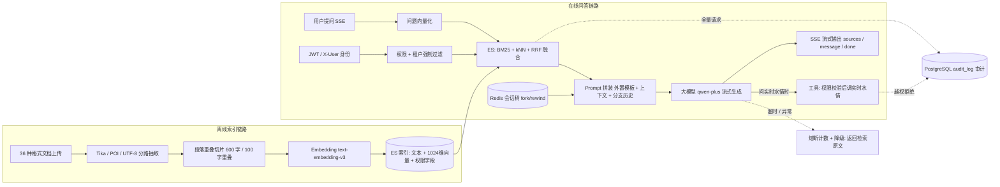

# 水利知识库智能问答系统（RAG）

基于 **Spring Boot 3.4 + Spring AI + Elasticsearch** 的检索增强生成（RAG）问答系统，面向水利规程、调度文档等专业知识库场景。包含 ES 混合检索（BM25 + kNN + RRF）、行级权限与多租户隔离、模型可插拔、pi-mono 风格会话树（fork/rewind）、OIDC/JWT 认证、工具权限治理、全量审计日志等能力。

## 功能清单

| 模块 | 说明 |
|---|---|
| 文档上传与解析 | **36 种格式**：txt/md/json/xml/yaml/sql/log 等纯文本直读；xls/xlsx/csv/tsv 保留"表头当字段名"语义；pdf/doc/docx/ppt/pptx/rtf/odt/html/epub 等由 Apache Tika 统一解析。空行切段 + 句子兜底，600 字切片 / 100 字重叠窗口；支持整文件夹递归上传 |
| ES 混合检索 | **BM25 全文 + kNN 向量 + RRF 融合**（应用层融合，兼容 ES 8.13），1024 维 dense_vector + HNSW；检索实验页可并排对比三种模式 |
| 权限与多租户 | 行级权限（owner / 用户组 / public）+ **租户隔离**：ES 文档、检索、增删改、Redis 会话树全部按当前租户强制过滤，调用方无法绕过 |
| RAG 问答链路 | 提问 → 向量化 → ES 混合检索 → 外置 Prompt 模板拼装上下文 → 大模型流式生成（SSE）；含来源溯源与超时/API 异常熔断降级（返回检索原文） |
| 模型可插拔 | 数据库配置 CHAT/EMBEDDING 模型，API Key 脱敏、连通性测试、切换即时生效；兼容公有云 API 与内网私有化模型（OpenAI 兼容协议） |
| 会话树 | pi-mono 风格消息树：**fork**（从任意历史节点开新支）/ **rewind**（只移动当前位置不删节点）；上下文只取祖先链，兄弟分支不串 |
| 认证与治理 | 零依赖 JWT（HS256）Bearer 认证，sub/groups/tenant claims；**工具权限白名单**（默认拒绝）；**审计日志**落 PostgreSQL，覆盖所有 API + 401 + 工具越权 |
| Web 前端 | 零依赖静态页（手写渲染，无需 npm）：问答页、文档管理、检索实验、模型配置、会话树、企业治理中心 |

## 架构图



## 技术栈

- Spring Boot 3.4.5 / Java 17
- Spring AI 1.0.x（OpenAI 兼容协议接入，ChatClient / VectorStore / @Tool）
- 通义千问 DashScope 兼容模式：`qwen-plus`（对话）+ `text-embedding-v3`（1024 维向量）
- Elasticsearch 8.13（BM25 + dense_vector HNSW + 应用层 RRF 融合，完全替代 pgvector）
- PostgreSQL（审计日志 audit_log + 模型配置 model_config，JdbcTemplate 自动建表）
- Redis 7（会话消息树：节点 Hash + head 指针 + 命名分支）
- Apache Tika 3.2（pdf/doc/docx/ppt/pptx/rtf/html/epub 等统一解析）+ POI 5.4（Excel 表头语义）
- 手写 JWT HS256 验签（零新增依赖）+ 零依赖静态前端页（无 npm 构建步骤）

> 为什么不用 DeepSeek 做默认：DeepSeek API **不提供 embedding 接口**，RAG 必须有向量模型。DashScope 一个 Key 同时提供 chat + embedding 且有免费额度。要换 DeepSeek 做对话模型，改 `AI_BASE_URL=https://api.deepseek.com`、`AI_CHAT_MODEL=deepseek-chat`，embedding 保留 DashScope 或另配（见 application.yml 注释）。

## 快速启动

前置：JDK 17、Maven 3.8+、Docker Desktop、本机 Redis（6379）。前端为零依赖静态页，无需 Node.js/npm。

### 方式 A：全部容器化部署（推荐演示）

```bash
# 1. 打包应用（本机 Maven 已缓存依赖）
mvn -DskipTests package

# 2. 设置 API Key（从启动 compose 的 shell 环境变量读取，不落文件、不进 Git）
#    Windows CMD: set AI_API_KEY=sk-xxxx     PowerShell: $env:AI_API_KEY="sk-xxxx"
#    Git Bash:    export AI_API_KEY=sk-xxxx

# 3. 构建镜像并启动（ES + PostgreSQL + app；Redis 默认用宿主机已启动的实例）
#    JWT 密钥可用环境变量 JWT_SECRET 覆盖（不设则用内置 Demo 密钥）
docker compose up -d --build app

# 4. 浏览器访问 http://localhost:8080（容器 8080 已映射到宿主机）
```

容器网络说明：容器内通过服务名 `postgres` 访问数据库（compose 内置 DNS），通过
`host.docker.internal` 访问宿主机的 Redis；两处地址由 `application.yml` 的环境变量
占位符（`DB_HOST` / `REDIS_HOST`）注入，本地 `mvn spring-boot:run` 启动时不设这些
变量即回落到 `localhost`，同一份配置兼容两种部署方式。

基础镜像说明：Dockerfile 基于 `pgvector/pgvector:pg16` + apt 安装 openjdk-17（未用
eclipse-temurin 官方镜像），原因是 Docker Hub 在受限网络下拉取超时，而 Debian 官方
apt 源可直连。网络通畅时可把 `FROM` 换回 `eclipse-temurin:17-jre`。

### 方式 B：本地启动应用 + 容器跑数据库（开发模式）

```bash
# 只起数据库容器（应用在本机跑，Redis 用本机实例）
docker compose up -d postgres

# 启动应用（不设 DB_HOST/REDIS_HOST 时自动用 localhost）
mvn spring-boot:run

# 浏览器直接访问 http://localhost:8080（零依赖静态页，应用自身托管）
# 页面入口：问答 / 会话树 / 检索实验 / 模型配置 / 文档管理 / 企业治理
```

若想把 Redis 也放进 Docker：`docker compose --profile docker-redis up -d --build app`，
并把应用环境变量 `REDIS_HOST` 设为 `redis`。

### 停止与清理

```bash
docker compose down               # 停止并移除容器（pgdata 卷保留，数据不丢）
docker compose down -v            # 连数据卷一起清（需重新入库所有文档）
docker compose up -d --build app  # 代码改动后：重新 package + 重建镜像启动
```

> `npm install` 若报 `EPERM`（全局 npm 缓存目录无写权限，常见于公司机器），改用工作区缓存：
> `npm install --cache ./.npm-cache`（`.npm-cache` 已加入 .gitignore）。
>
> **零依赖方案**：`src/main/resources/static/index.html` 已内置一份**功能完整的专业问答页**（会话管理 / 拖拽上传 / SSE 打字机 / 引用卡片，纯静态无构建）。只启动后端后直接访问 `http://localhost:8080` 即可使用，不需要 Node 和 npm。`frontend/` 的 Vue 工程是组件化增强版，供定制开发。
>
> 打包部署 Vue 版：`cd frontend && npm run build`，把 `frontend/dist/` 下的内容拷到
> `src/main/resources/static/` 覆盖 index.html 后重新启动后端，访问 `http://localhost:8080`。

### 接口示例

```bash
# 查询支持格式（30+ 种）
curl http://localhost:8080/api/docs/formats

# 上传示例文档（项目自带 sample-docs/云溪水库调度规程节选.md；也可换 docx/xlsx/pdf 等）
curl -F "file=@src/main/resources/sample-docs/云溪水库调度规程节选.md" http://localhost:8080/api/docs/upload
# => {"fileName":"...","chunks":3,"chars":1200}

# RAG 问答（SSE 流式，-N 关闭缓冲逐条看事件）
curl -N -X POST http://localhost:8080/api/chat/stream \
  -H "Content-Type: application/json" \
  -d "{\"sessionId\":\"demo-001\",\"question\":\"云溪水库的汛限水位是多少？汛期怎么控制下泄流量？\"}"
# 事件流示例：
# event: sources   data: [{"fileName":"云溪水库调度规程节选.md","chunkIndex":"1","preview":"..."}]
# event: message   data: 云溪水库
# event: message   data: 的汛限水位为
# event: done      data: [DONE]

# 问答历史（Redis）
curl "http://localhost:8080/api/chat/history?sessionId=demo-001"
curl -X DELETE "http://localhost:8080/api/chat/history?sessionId=demo-001"

# Tool Calling：问"实时水位"会触发模型调用工具
curl -N -X POST http://localhost:8080/api/chat/stream \
  -H "Content-Type: application/json" \
  -d "{\"sessionId\":\"demo-001\",\"question\":\"云溪水库现在的实时水位是多少？\"}"

# 工具直调（不经过大模型，验证工具本身）
curl -X POST "http://localhost:8080/api/chat/tool/water?station=云溪水库"
```

> 没装 Docker 的替代方案：本机安装 PostgreSQL 16 + 手动执行 `CREATE EXTENSION vector;`（需先装 pgvector 扩展），Redis 用 Memurai 或 WSL 里的 redis-server。

## 设计决策

| 问题 | 决策 | 理由 |
|---|---|---|
| 为什么选 pgvector 不选 Milvus/ES | pgvector | 文档量在百万级以内，pgvector 精度与吞吐足够；与业务数据同库，事务/备份/运维一套体系；团队已有 PG 经验，引入成本最低。Milvus 适合亿级向量 + 高并发检索的独立场景，这个项目里是过度设计 |
| 切片参数 600 字 / 100 字重叠 | 见 `ParagraphSplitter` 注释 | 600 字 ≈ 400~600 token，远低于 embedding 模型 8192 上限且语义完整；太大检索噪声多，太小句子截断语义不完整；100 字重叠 ≈ 1~2 句，缓解"答案切在两片之间"的召回空洞。参数已外置，可网格搜索调优 |
| 手写 RAG 链路不用 QuestionAnswerAdvisor | 见 `RagChatService` 注释 | Advisor 封装过黑盒：检索结果拿不到、来源没法溯源、降级做不了。手写每步可观测可干预，引用溯源和熔断降级正是在这些缝隙里实现的 |
| 手写熔断器不用 Resilience4j | 见 `LlmCircuitBreaker` 注释 | Demo 只需"连续失败 N 次 → 熔断 M 秒 → 半开重试"最小闭环，40 行代码可控可讲 |
| SSE 而非 WebSocket | 见 `ChatController` 注释 | LLM 问答是单向服务端推送，SSE 基于 HTTP、自带重连、Nginx 友好 |
| Prompt 外置 + 简单占位符替换 | 见 `PromptTemplateLoader` 注释 | ST4 对大括号敏感（模板里可能嵌 JSON 示例），字面量替换行为可预期；改提示词不用重新编译 |
| 相似度阈值 0.4 | application.yml | 低相关片段是幻觉的主要诱因之一，宁缺毋滥；配合系统提示词"找不到就明说"双重防御 |
| 多格式解析用 Tika + POI 双轨 | `DocumentIngestService` | Tika 一个库覆盖几十种富文档格式，避免逐格式引入解析器；但表格经 Tika 抽取后只剩裸值，丢失列头对应关系，所以 xls/xlsx/csv/tsv 单独走 POI/手写解析，把表头拼成"列名：值"再入库，检索命中率更高 |
| 前端用 Vue 3 + Vite 而非静态页 | `frontend/` | 会话管理、流式打印、引用卡片等交互状态多，组件化更好维护；Vite 代理解决开发期跨域，构建产物可直接放进 static 目录部署 |

## 项目结构

```
water-rag-demo
├── Dockerfile                          # 应用镜像（pg 基础镜像 + apt JRE，见"快速启动"说明）
├── .dockerignore                       # 构建上下文裁剪
├── docker-compose.yml                  # pgvector + app 编排（Redis 为可选 profile）
├── init/init.sql                       # 启用 vector 扩展
├── frontend/                           # Vue 3 + Vite 问答页面
│   ├── vite.config.js                  # 开发代理 /api → localhost:8080
│   └── src/
│       ├── App.vue                     # 主页面：会话/消息问答逻辑
│       ├── api.js                      # fetch + ReadableStream 解析 SSE
│       └── components/                 # Sidebar / MessageBubble / SourceCard
├── src/main/resources
│   ├── application.yml                 # 全部可调参数（含注释）
│   ├── prompts/rag-system.st           # 外置 Prompt 模板
│   └── sample-docs/                    # 示例文档
└── src/main/java/com/joylin/waterkb
    ├── config/RagProperties            # 参数绑定
    ├── rag/ParagraphSplitter           # 中文段落重叠切片
    ├── rag/DocumentIngestService       # 解析 → 切片 → 入库
    ├── rag/RagChatService              # 检索 → 拼装 → 流式生成（核心链路）
    ├── rag/PromptTemplateLoader        # 外置模板加载
    ├── memory/RedisConversationStore   # Redis 会话历史
    ├── resilience/LlmCircuitBreaker    # 熔断降级
    ├── tool/WaterInfoTool              # Tool Calling 示例
    └── web/                            # Controller / DTO / 全局异常
```

## 测试

```bash
mvn test   # 38 例：切片5 + 熔断6 + 多格式7 + RRF/DSL/权限5 + JWT4 + 工具权限5 + 脱敏3 + 其他
mvn package -DskipTests   # 打包后 docker compose up -d --build app
```

测试覆盖说明：
- `DocumentIngestServiceTest`：Mockito 捕获 `vectorStore.add()` 参数，验证 xlsx 表头语义、csv 引号转义、docx 经 Tika 真实解析、非法/空文件拒绝，**无需真实数据库和 API Key**；
- `EsHybridSearchServiceTest`：RRF 跨路去重/Top-K 截断、BM25 与 kNN DSL 结构、权限 filter 强制注入租户与用户组；
- `JwtServiceTest`：合法 token、篡改签名、过期、格式错误四类路径；
- `ToolPermissionRegistryTest`：默认拒绝、组命中放行、管理员放行、未注册工具拒绝；
- `ParagraphSplitterTest` / `LlmCircuitBreakerTest` / `ModelConfigTest`：切片边界、熔断状态机、API Key 脱敏。

## 企业能力演示

浏览器打开 `http://localhost:8080/governance.html`（企业治理中心），可现场演示：

| 演示项 | 操作 | 预期效果 |
|---|---|---|
| 认证 | 治理页签发演示 Token，用 `Authorization: Bearer xxx` 调 `/api/auth/me` | 返回 JWT 里的用户/组/租户；伪造或过期 Token 返回 401 |
| 多租户 | 分别以 `X-Tenant: dept-a` / `dept-b` 上传同名文件 | 两租户检索/列表互不可见；跨租户删除返回"不存在" |
| 行级权限 | 匿名 / water-dept 组用户查同一问题 | 匿名只见 public 文档，组内用户可见内部文档 |
| 工具权限 | 匿名 / outsider / water-dept 调 `/api/chat/tool/water` | 前两者返回 PERMISSION_DENIED，后者返回水情数据 |
| 会话树 | 问答页顶栏进「会话树」，从历史节点 fork 或 rewind | 新分支保留旧分支；切回旧分支上下文不串 |
| 审计 | 治理页查看审计日志 | 每次 API 调用、401、工具越权均有记录，按租户隔离 |

## 已知边界与可扩展方向

- 扫描版 PDF / 图片型文档（png/jpg）不支持，需先接 OCR 才有文本可切；
- 表格单 sheet 最多读 5000 行、100 列（防内存溢出，可在 `DocumentIngestService` 常量调整）；
- ES 中文用 standard analyzer 按字符切分，BM25 召回宽、精度低，靠向量检索弥补；生产可换 IK 分词插件；
- RRF 在应用层实现（两次 ES 往返），兼容 ES 8.13；ES 8.15+ 可换原生 retriever 减一次往返；
- JWT 用 HS256 共享密钥 + 演示签发端点；生产应对接真实 IdP 的 JWKS 验签并关闭签发端点；
- 会话树节点目前不裁剪（永久保留），大体量场景需加节点上限与冷归档；
- 多轮追问可加 query 改写（把"那它的校核水位呢"改写成独立问题再检索）；
- 工具权限目前是内存规则表，生产应落到数据库并支持运行时配置。
