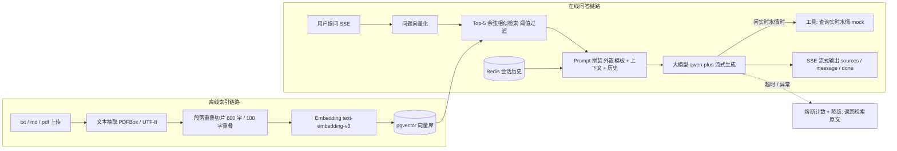

# 水利知识库智能问答系统（RAG）

基于 **Spring Boot 3.4 + Spring AI + pgvector** 的检索增强生成（RAG）问答系统，面向水利规程、调度文档等专业知识库场景。支持文档上传解析、中文段落重叠切片、向量相似度检索、SSE 流式回答、Tool Calling、Redis 会话历史与熔断降级。

## 功能清单

| 模块 | 说明 |
|---|---|
| 文档上传与解析 | txt / md / pdf（PDFBox），空行切段 + 句子兜底切分，600 字切片 / 100 字重叠窗口 |
| RAG 问答链路 | 提问 → 向量化 → pgvector Top-5 相似检索 → 外置 Prompt 模板拼装上下文 → 大模型流式生成（SSE） |
| Tool Calling | 注册"查询实时水情"mock 工具，模型自主决定何时调用（问实时水位时触发） |
| 工程化 | Redis 会话历史（会话 ID 隔离、TTL、窗口裁剪）、超时 + API 异常的熔断降级（降级返回检索原文）、Prompt 模板外置配置 |

## 架构图



## 技术栈

- Spring Boot 3.4.5 / Java 17
- Spring AI 1.0.x（OpenAI 兼容协议接入）
- 通义千问 DashScope 兼容模式：`qwen-plus`（对话）+ `text-embedding-v3`（1024 维向量）
- PostgreSQL + pgvector（HNSW 索引、余弦距离）
- Redis 7（对话历史）
- PDFBox 3.x（PDF 文本抽取）

> 为什么不用 DeepSeek 做默认：DeepSeek API **不提供 embedding 接口**，RAG 必须有向量模型。DashScope 一个 Key 同时提供 chat + embedding 且有免费额度。要换 DeepSeek 做对话模型，改 `AI_BASE_URL=https://api.deepseek.com`、`AI_CHAT_MODEL=deepseek-chat`，embedding 保留 DashScope 或另配（见 application.yml 注释）。

## 快速启动

前置：JDK 17、Maven 3.8+、Docker Desktop。

```bash
# 1. 启动 pgvector 数据库 + Redis
docker compose up -d

# 2. 配置大模型 API Key（阿里云百炼 https://bailian.console.aliyun.com 创建）
#    Windows CMD: set AI_API_KEY=sk-xxxx     PowerShell: $env:AI_API_KEY="sk-xxxx"
export AI_API_KEY=sk-xxxx

# 3. 启动应用（首次启动自动建 vector_store 表）
mvn spring-boot:run
```

### 接口示例

```bash
# 上传示例文档（项目自带 sample-docs/云溪水库调度规程节选.md）
curl -F "file=@src/main/resources/sample-docs/云溪水库调度规程节选.md" http://localhost:8080/api/docs/upload
# => {"fileName":"...","chunks":3,"chars":1200}

# RAG 问答（SSE 流式，-N 关闭缓冲逐条看事件）
curl -N -X POST http://localhost:8080/api/chat/stream \
  -H "Content-Type: application/json" \
  -d "{\"sessionId\":\"demo-001\",\"question\":\"云溪水库的汛限水位是多少？汛期怎么控制下泄流量？\"}"
# 事件流示例：
# event: sources   data: [{"fileName":"云溪水库调度规程节选.md","chunkIndex":"1","preview":"..."}]
# event: message   data: 云溪水库
# event: message   data: 的汛限水位为
# event: done      data: [DONE]

# 问答历史（Redis）
curl "http://localhost:8080/api/chat/history?sessionId=demo-001"
curl -X DELETE "http://localhost:8080/api/chat/history?sessionId=demo-001"

# Tool Calling：问"实时水位"会触发模型调用工具
curl -N -X POST http://localhost:8080/api/chat/stream \
  -H "Content-Type: application/json" \
  -d "{\"sessionId\":\"demo-001\",\"question\":\"云溪水库现在的实时水位是多少？\"}"

# 工具直调（不经过大模型，验证工具本身）
curl -X POST "http://localhost:8080/api/chat/tool/water?station=云溪水库"
```

> 没装 Docker 的替代方案：本机安装 PostgreSQL 16 + 手动执行 `CREATE EXTENSION vector;`（需先装 pgvector 扩展），Redis 用 Memurai 或 WSL 里的 redis-server。

## 设计决策

| 问题 | 决策 | 理由 |
|---|---|---|
| 为什么选 pgvector 不选 Milvus/ES | pgvector | 文档量在百万级以内，pgvector 精度与吞吐足够；与业务数据同库，事务/备份/运维一套体系；团队已有 PG 经验，引入成本最低。Milvus 适合亿级向量 + 高并发检索的独立场景，这个项目里是过度设计 |
| 切片参数 600 字 / 100 字重叠 | 见 `ParagraphSplitter` 注释 | 600 字 ≈ 400~600 token，远低于 embedding 模型 8192 上限且语义完整；太大检索噪声多，太小句子截断语义不完整；100 字重叠 ≈ 1~2 句，缓解"答案切在两片之间"的召回空洞。参数已外置，可网格搜索调优 |
| 手写 RAG 链路不用 QuestionAnswerAdvisor | 见 `RagChatService` 注释 | Advisor 封装过黑盒：检索结果拿不到、来源没法溯源、降级做不了。手写每步可观测可干预，引用溯源和熔断降级正是在这些缝隙里实现的 |
| 手写熔断器不用 Resilience4j | 见 `LlmCircuitBreaker` 注释 | Demo 只需"连续失败 N 次 → 熔断 M 秒 → 半开重试"最小闭环，40 行代码可控可讲 |
| SSE 而非 WebSocket | 见 `ChatController` 注释 | LLM 问答是单向服务端推送，SSE 基于 HTTP、自带重连、Nginx 友好 |
| Prompt 外置 + 简单占位符替换 | 见 `PromptTemplateLoader` 注释 | ST4 对大括号敏感（模板里可能嵌 JSON 示例），字面量替换行为可预期；改提示词不用重新编译 |
| 相似度阈值 0.4 | application.yml | 低相关片段是幻觉的主要诱因之一，宁缺毋滥；配合系统提示词"找不到就明说"双重防御 |

## 项目结构

```
water-rag-demo
├── docker-compose.yml                  # pgvector + Redis 一键启动
├── init/init.sql                       # 启用 vector 扩展
├── src/main/resources
│   ├── application.yml                 # 全部可调参数（含注释）
│   ├── prompts/rag-system.st           # 外置 Prompt 模板
│   └── sample-docs/                    # 示例文档
└── src/main/java/com/joylin/waterkb
    ├── config/RagProperties            # 参数绑定
    ├── rag/ParagraphSplitter           # 中文段落重叠切片
    ├── rag/DocumentIngestService       # 解析 → 切片 → 入库
    ├── rag/RagChatService              # 检索 → 拼装 → 流式生成（核心链路）
    ├── rag/PromptTemplateLoader        # 外置模板加载
    ├── memory/RedisConversationStore   # Redis 会话历史
    ├── resilience/LlmCircuitBreaker    # 熔断降级
    ├── tool/WaterInfoTool              # Tool Calling 示例
    └── web/                            # Controller / DTO / 全局异常
```

## 已知边界与可扩展方向

- 扫描版 PDF（图片型）不支持，需接 OCR；
- 纯向量检索，可升级为 BM25 + 向量混合检索 + rerank 提升召回质量；
- 多轮追问可加 query 改写（把"那它的校核水位呢"改写成独立问题再检索）；
- 未做用户鉴权，接入生产前需补登录与限流。
